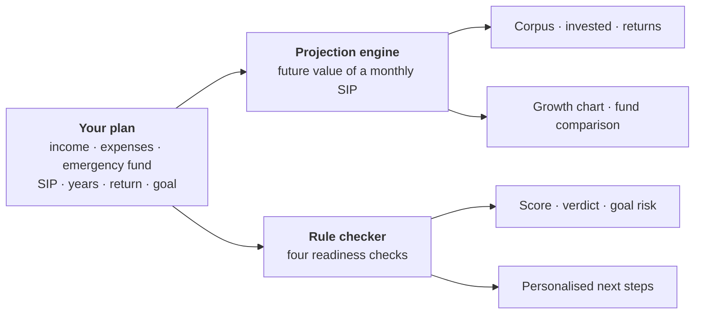

<div align="center">

# SIP**Wise**

### Know whether your monthly SIP will actually get you there.

A fast, private SIP goal planner. Enter a few numbers and get your projected corpus, a readiness score and the exact next steps, all on one screen.


[🚀 Features](#-features) · [🧭 How it works](#-how-it-works) · [🧩 Code tour](#-code-tour) · [✅ Code quality](#-code-quality) · [📌 Roadmap](#-roadmap)

[🌐 Live demo](https://rishabh-stacks.github.io/SIPWISE-investment-advisor/) 

</div>

---

## ✨ Why SIPWise

Most SIP calculators stop at one big number. That number feels good, but it doesn't tell you whether you are on track. SIPWise is built around the questions that actually change what you do next.

- **See the gap, not just the number.** Your projection is set against your goal, so you know in rupees whether you are ahead or short, and what monthly SIP would close the gap. A specific gap is something you can act on. A vague worry is not.
- **Watch compounding work for you.** Invested money and returns are shown side by side. At ₹8,000 a month for 10 years at 12%, you put in ₹9.6 lakh and the projection reaches ₹18.6 lakh, so returns come close to matching your own contributions.
- **Check the foundations first.** Four simple rules test your saving rate, emergency cushion, time horizon and goal, so the plan you start is one you can stick with.
- **Zero friction, zero risk.** No sign-up, no server, no data collection. Everything runs in your browser and updates live as you type, so you can nudge the SIP up and watch the gap close in real time.

## 🚀 Features

| | |
|---|---|
| **Live projection** | Corpus, amount invested and returns update on every keystroke |
| **Readiness score** | Score, verdict (Ready / Partly ready / Not ready) and goal-risk level from four rule checks |
| **Interactive growth chart** | Hover to compare years, click a year for its numbers, dashed line marks your goal |
| **Breakdown and rules charts** | Invested vs returns split, and which rules you pass or fail |
| **Fund type comparison** | Same SIP projected at sample debt, hybrid and equity returns |
| **Next steps** | Personalised tips for each failed rule, plus a KYC documents checklist |
| **Saved plans** | Keep plans in your browser and review them later |
| **Report download** | Export your plan as a plain-text report |
| **Light and dark themes** | Remembers your choice, defaults to your system setting |
| **Responsive and accessible** | Works from phone to desktop, keyboard-friendly tooltips, reduced-motion support |

## 🧭 How it works



Your inputs feed two independent pieces of logic. The projection engine calculates what your SIP grows into. The rule checker scores your plan against four sensible checks. Both results are rendered together so the numbers and the advice always agree.

### The rules

Score = rules passed ÷ 4 × 100. All four is **Low** risk, two or three is **Medium**, and zero or one is **High**.

| Rule | Passes when |
|---|---|
| Saving rate | SIP is at least 10% of monthly income |
| Emergency fund | Fund covers 6 months of expenses |
| Time horizon | You invest for 5 years or more |
| Goal reachable | Projected value meets your goal amount |

### The math

SIP instalments are assumed to be paid at the start of each month.

```text
FV  = P × [((1 + i)^n − 1) / i] × (1 + i)      projected corpus
P   = FV × i / [((1 + i)^n − 1) × (1 + i)]     SIP needed to reach a goal

P = monthly SIP · i = annual rate ÷ 1200 · n = months
```

## 🧩 Code tour

Plain HTML, CSS and JavaScript with no build step and nothing to install. The only dependency is [📊 Chart.js](https://www.chartjs.org/) 4.4.0, loaded from the [🌐 jsDelivr](https://www.jsdelivr.com/) CDN.

```text
├── index.html     page structure: form, result cards, chart canvases
├── style.css      theme tokens, layout, tooltips, responsive rules
├── script.js      calculations, rendering, charts, storage, report
└── favicon.svg
```

### Key functions in `script.js`

| Function | Role |
|---|---|
| `futureValue()` / `requiredSip()` | Pure maths: the projection and its inverse |
| `evaluate()` | Runs the four rules and returns score, verdict, risk level and tips |
| `readForm()` | Reads and clamps inputs (years 1 to 40, rate 0 to 30) |
| `render()` | Single pipeline that updates the hero, stats, tips, fund cards and charts |
| `buildCharts()` / `updateCharts()` | Creates the three Chart.js charts, then feeds them new data |
| `savePlan()` / `renderHistory()` | Saved plans in `localStorage` (latest 20 kept, 5 shown) |
| `downloadReport()` | Builds a text report with the Blob and URL APIs |
| `setTheme()` | Toggles the theme, saves it and rebuilds the charts |

### Make it yours

Everything worth tweaking sits near the top of `script.js` or inside `evaluate()`: the `fundTypes` array (names and sample returns), the `requiredDocs` checklist, and the rule thresholds (10% saving rate, 6 months of expenses, 5 years).

## ✅ Code quality

SIPWise is a small project, but it is written with the habits of production front-end code: clear boundaries, defensive handling of input, and care for the people using it.

| Quality | How it shows up in the code |
|---|---|
| **Separation of concerns** | `futureValue`, `requiredSip` and `evaluate` are pure functions with no DOM access. Rendering, charts, storage and reporting each live in their own functions, so every piece can be read, changed or tested on its own. |
| **Single source of truth** | Every input event runs one `render()` pipeline and stores a `latest` snapshot. The hero, stats, tips, fund cards and charts can never disagree. |
| **Defensive input handling** | `readForm()` turns blanks and negatives into zero and caps years and return. The maths guards a 0% rate and zero months, and rules that need income or expenses ask for them instead of passing on empty fields. |
| **Honest empty state** | The form starts blank, a `complete` check gates every output, and Save and Download stay disabled until a plan can actually be projected. |
| **Security basics** | User text is escaped with `escapeHtml()` before it reaches `innerHTML`, external links use `rel="noopener"`, and nothing is sent anywhere. The only network request is loading Chart.js. |
| **Resilience** | Every `localStorage` call sits in a `try/catch`, so private mode can't break the app. If Chart.js fails to load, the calculations still work. A `pageshow` reset stops browsers restoring stale values, and Enter no longer reloads the page. |
| **Performance** | Scripts load with `defer`, there is no framework or build step, and charts are created once per theme and updated in place on each input rather than rebuilt. |
| **Maintainability** | Config such as `fundTypes` and `requiredDocs` sits at the top of the file, colours are CSS custom properties (dark mode overrides tokens only), and comments explain the why and document the formulas beside the code. |
| **Accessibility and responsiveness** | Semantic HTML, labelled inputs, visible focus outlines, keyboard-focusable tooltips, `aria-label` on chart canvases, reduced-motion support, and breakpoints at 860px and 480px. |
| **Standards first** | HTML5, CSS Grid and Flexbox, ES6 and standard web APIs (Blob, URL, `localStorage`), with a single dependency. |

Next on the quality roadmap: automated tests for the pure calculation functions.

## 📌 Roadmap

- [ ] Step-up SIP and lump-sum investing
- [ ] Inflation-adjusted goals
- [ ] Year-wise return variation
- [ ] Tax estimates
- [ ] Print-ready PDF report
- [ ] Unit tests for `futureValue`, `requiredSip` and `evaluate`
- [ ] Text alternatives for the charts

## ⚠️ Disclaimer

SIPWise is a learning project. Projections assume constant returns, and fund-type figures are samples for illustration only. Scores follow simple rules and are **not financial advice**.

---

<div align="center">

Built with [📚 MDN-documented web standards](https://developer.mozilla.org/) and [📊 Chart.js](https://www.chartjs.org/)

</div>
